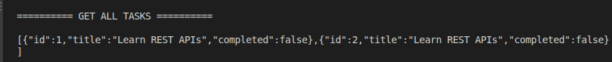
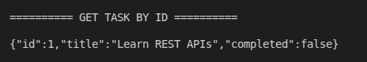
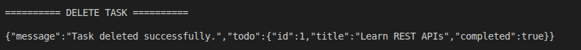

# To-Do App RESTful API

A simple RESTful API built with Node.js core modules to manage to-do tasks using in-memory storage.

## Features

- Create, read, update, and delete tasks (CRUD)
- RESTful routes and HTTP methods
- Request validation and JSON parsing
- Appropriate HTTP status codes and error handling
- In-memory storage using an array

## API Endpoints

| Method | Endpoint     | Description   |
| ------ | ------------ | ------------- |
| GET    | `/todos`     | Get all tasks |
| GET    | `/todos/:id` | Get a task    |
| POST   | `/todos`     | Create a task |
| PUT    | `/todos/:id` | Update a task |
| DELETE | `/todos/:id` | Delete a task |

## Screenshots

